<p align="center">
  
</p>

# Wipewatch

<p align="center">
  <a href="https://github.com/crayosog-star/wipewatch/releases/latest/download/Wipewatch-Solo-Setup.exe"></a>
  <a href="https://github.com/crayosog-star/wipewatch/releases/latest"></a>
  
  
</p>

A free Windows desktop app for **Rust players**: it watches **drops, skin prices, servers and updates** for you, helps you **plan every wipe**, and keeps your **friends and clan** in the loop. It lives in your tray, alerts you the moment something happens, and keeps everything you check between sessions in one place.

- **Drops at a glance**: one page that says whether any Rust drop is live on Kick or Twitch right now and what it gives, with your watch progress and an "ending soon" alert
- **Skins priced from the Steam Market**: reads your public inventory and shows total value, value after Steam's fee, 24-hour change, price history and sparklines, **price alerts**, a **watchlist** for skins you do not own, and **profit and loss** on what you paid
- **Server browser**: live players and queue, the **map for the current wipe**, favourites, alerts for queue, population and **wipe**, one-click join, and which Steam friends are playing
- **Friends and Clans**: add friends, choose **exactly what you share** (skin value, activity, recent servers, hours, playing now), keep your profile **open or private**, and form a clan with a combined skin value
- **Build Ideas**: recent, popular base-build videos from creators you follow, ranked by views for their age, with filters for solo, duo, bunker, cheap and more
- **Wipe Planner**: a wipe-day checklist that **resets itself every force wipe**, notes, and **base pins** you drop on a server's map
- **Patch notes and calendar**: official update posts with images, a live countdown to the next monthly update and force wipe, and a month view of wipes, updates and drop campaigns
- **Raid calculator** with an editable cost table
- **Alerts your way**: Windows pop-ups, optional Discord webhook, three alert sounds, quiet hours, and a small **always-on-top mini overlay** with the wipe countdown, skin value and your favourite servers
- **Lives in the system tray**: closing the window keeps alerts running; the tray menu shows your skin value and the next wipe
- **Polished to live with**: command palette (`Ctrl+K`), light and dark themes, one-click CSV export, backup and restore, startup with Windows, a launch animation
- **Normal Windows installer**: per-user, no admin rights, Start Menu and Desktop shortcuts, uninstaller

> [!NOTE]
> The screenshots and demo below use **sample data**: the skins are real public Steam Market listings with their real prices, but the inventory, servers, friends, clan and drop campaign are made up. Your own pages show your own Steam inventory, servers and friends.

---

## See it in action

<p align="center">
  
</p>

---

## Download

Grab the latest version from the [**Releases page**](../../releases/latest):

| File | What it is |
|---|---|
| [`Wipewatch-Solo-Setup.exe`](../../releases/latest/download/Wipewatch-Solo-Setup.exe) | **Installer (recommended).** The **Solo edition**: everything above except Friends and Clans. A standard per-user install with Start Menu and Desktop shortcuts and an uninstaller under *Settings → Apps*. |
| *Full edition* | The same app **with** Friends and Clans. Build it yourself with `npm run installer` (see [Build it yourself](#build-it-yourself)); it needs a [Wipewatch server](server/README.md) that someone in your group hosts. |

The installer is **not code-signed**, so Windows SmartScreen may ask you to confirm: click **More info → Run anyway**. The release notes list the SHA-256 checksum so you can verify your download.

### Updating

- **Check from the app:** open **Settings → Updates**, enter this repository as `crayosog-star/wipewatch`, and press **Check for updates**. If a newer release exists you get a notice with a link to download it. Wipewatch only tells you and opens the page: it never downloads or installs anything by itself.
- **Fresh download:** the newest installer is always at
  [`releases/latest/download/Wipewatch-Solo-Setup.exe`](https://github.com/crayosog-star/wipewatch/releases/latest/download/Wipewatch-Solo-Setup.exe).
  Running it over an existing install keeps your settings, history and alerts.

---

## Requirements

| Requirement | Why |
|---|---|
| Windows 10 or 11, 64-bit | Wipewatch is a Windows desktop app |
| A Steam account with a **public** inventory | To show and price your skins. Wipewatch finds the account signed in on the PC automatically |
| A free [Steam Web API key](https://steamcommunity.com/dev/apikey) *(optional)* | Unlocks the server list, Steam friends playing and My Stats |
| A free [Twitch Client ID](https://dev.twitch.tv/console) *(optional, client type Public)* | Shows which Twitch streams have Drops enabled |
| A Discord webhook *(optional)* | Sends drop and price alerts to a channel of yours |
| Internet | Steam Market prices, news, server maps, Kick drops |

> [!TIP]
> For Friends, My Stats and "friends playing" to work, set your Steam **inventory**, **friends list** and **game details** to **Public** in Steam's privacy settings. Your keys, webhook and logins stay on your PC and are never written into backups.

---

## Screenshots

<p align="center">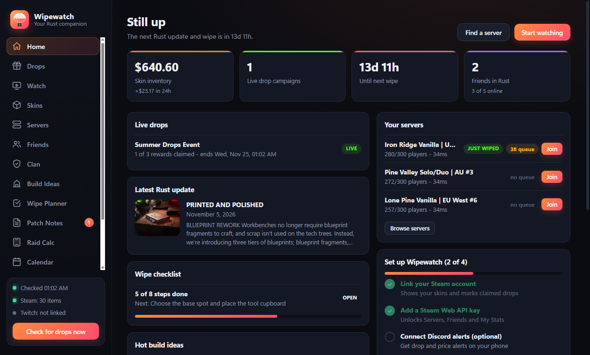<br><b>Home</b>: skin value, live drops, the countdown to the next wipe, your wipe checklist, hot build ideas and more at a glance</p>

<table>
  <tr>
    <td width="50%">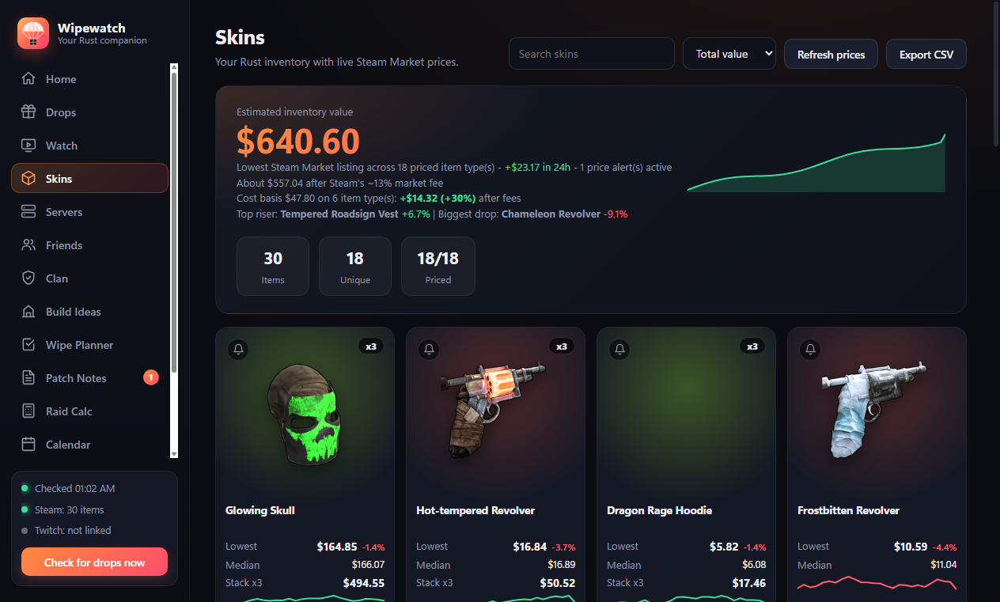<br><b>Skins</b>: your inventory priced from the Steam Market, with history, 24h change, alerts and profit and loss</td>
    <td width="50%">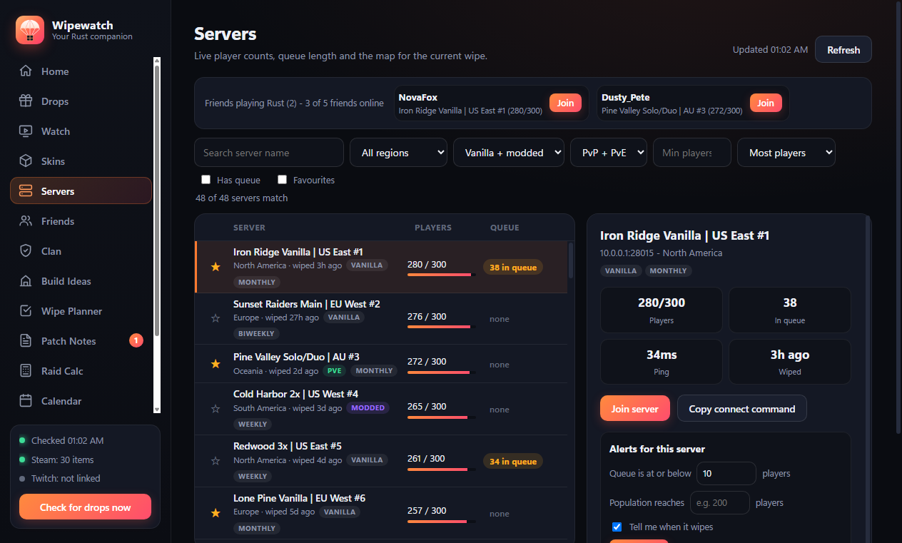<br><b>Servers</b>: live players and queue, alerts, and the map for the current wipe with your base pins</td>
  </tr>
  <tr>
    <td>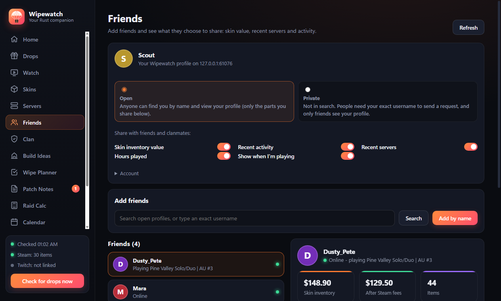<br><b>Friends</b>: open or private profile, a switch for everything you share, and each friend's value, servers and activity</td>
    <td>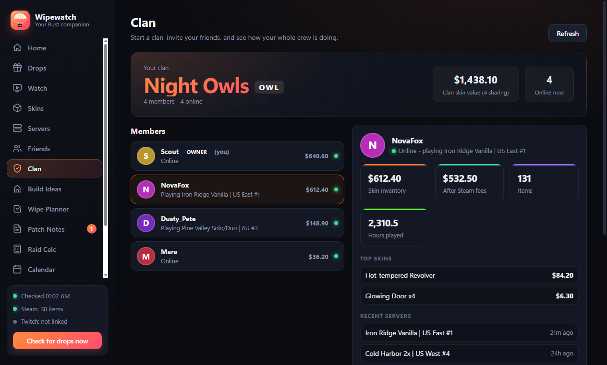<br><b>Clan</b>: invite friends, see every member and the combined skin value of the crew</td>
  </tr>
  <tr>
    <td>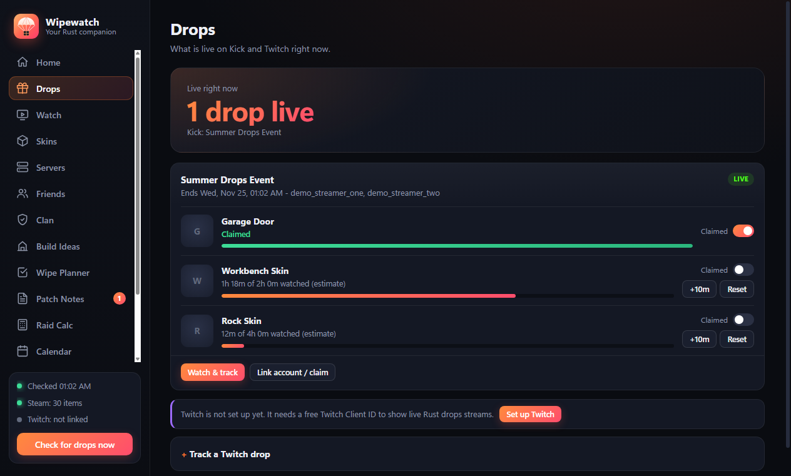<br><b>Drops</b>: whether anything is live right now, and what it gives</td>
    <td>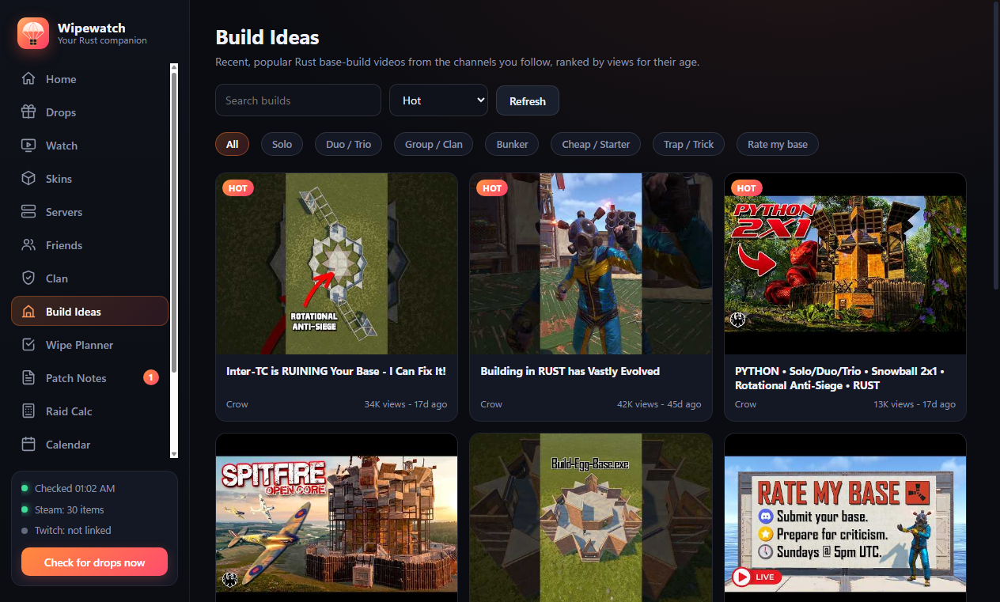<br><b>Build Ideas</b>: fresh base designs ranked by how fast they are catching on</td>
  </tr>
  <tr>
    <td>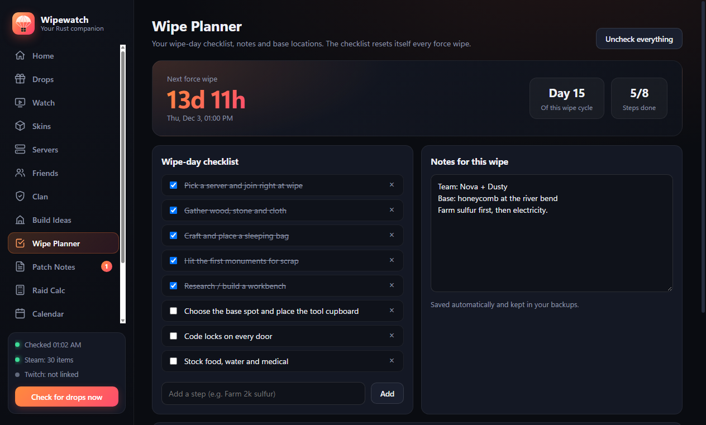<br><b>Wipe Planner</b>: checklist, notes and base pins for the current wipe</td>
    <td>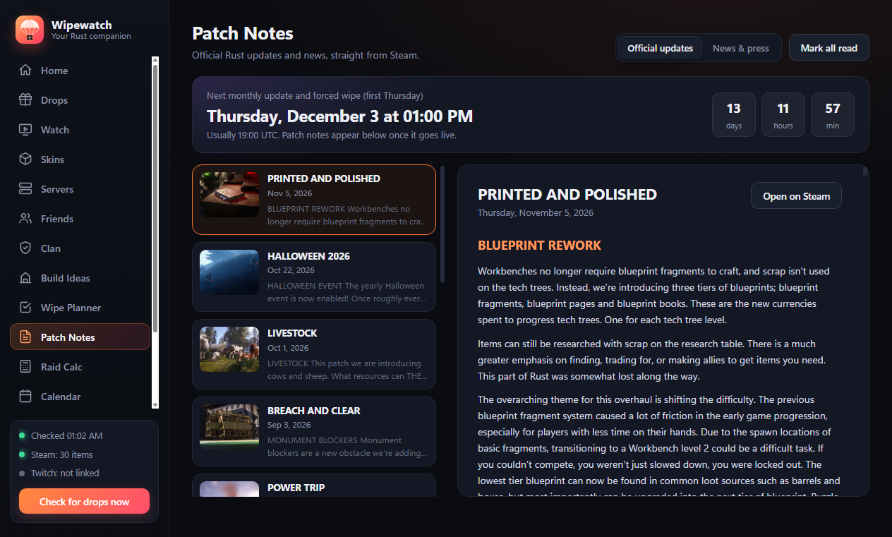<br><b>Patch Notes</b>: official posts with a live countdown to the next wipe</td>
  </tr>
  <tr>
    <td>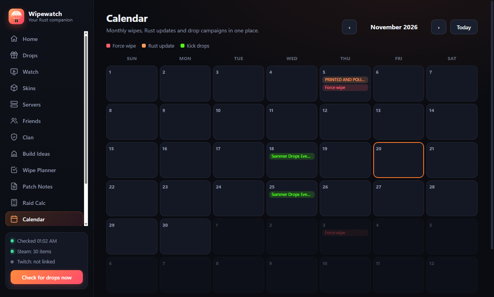<br><b>Calendar</b>: force wipes, updates and drop campaigns by month</td>
    <td>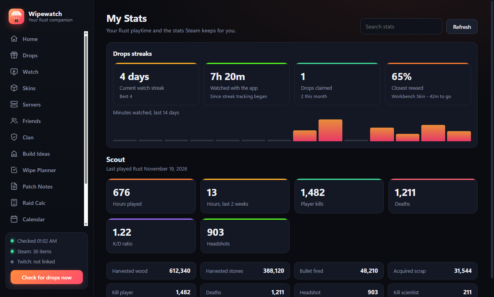<br><b>My Stats</b>: watch streaks, playtime and the stats Steam keeps for you</td>
  </tr>
</table>

---

## How it's built

Wipewatch is an [Electron](https://www.electronjs.org/) app written in plain JavaScript with no build step and no runtime dependencies. The window and the work behind it are kept apart: the window only draws, and everything that touches the network, the disk or Windows happens in the main process.

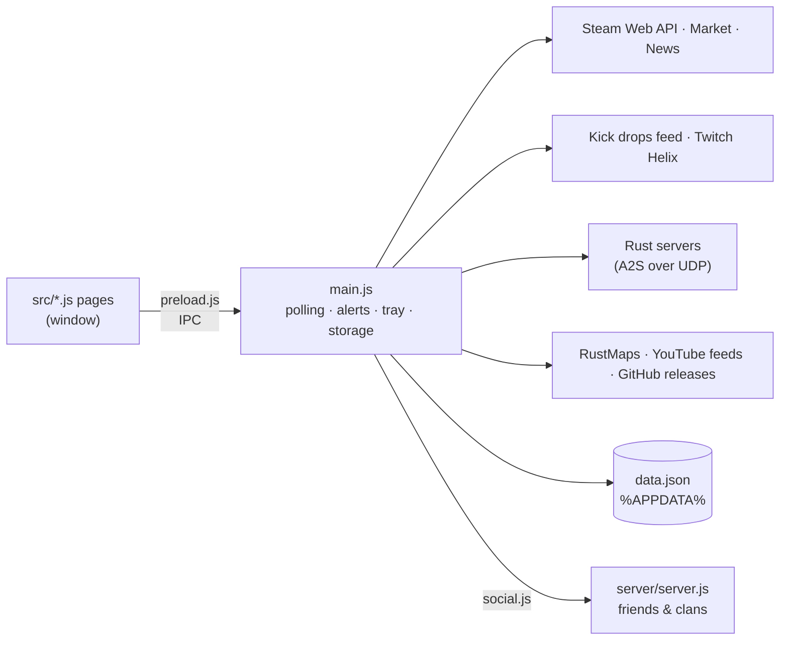

### 1. The window

A set of plain scripts (`app.js`, `home.js`, `extras.js`, `social-ui.js`, ...) that share one global scope and draw each page with a tiny `h()` helper that builds DOM nodes. **Nothing from a server, feed or another user is ever put into the page as HTML**, only as text, and the page's content security policy only allows local scripts.

### 2. The main process (`src/main.js`)

- Polls Kick, Twitch, Steam news and prices on timers, remembers what it has already told you, and sends **Windows pop-ups, Discord messages and sounds** (muted during your quiet hours).
- Keeps everything in one JSON file under `%APPDATA%\Rust Drops Tracker` (the folder name predates the rename and is kept so nothing is lost). Backups never contain your Discord webhook, Steam key, Twitch login or friends account key.
- **Prices:** Steam rate limits market lookups per IP. Wipewatch spaces requests out, falls back to Steam's market search when the price endpoint says 429, and backs off for longer each time it is blocked, remembering that across restarts.
- **Servers:** the list comes from Steam's official server list; live player counts, queue and map seed come straight from each game server with Valve's A2S query protocol; the map image is looked up on RustMaps.
- A self-test (`npm run smoke`) drives the whole interface headlessly and checks it.

### 3. Friends and clans (`server/server.js`)

A single file with no dependencies that one person in your group hosts. See [`server/README.md`](server/README.md) for running it and making it reachable over https.

| Rule | How it works |
|---|---|
| **Open** profile | Findable by name, viewable by anyone (only the fields the owner shares) |
| **Private** profile | Hidden from search, needs the exact username to send a request, viewable only by friends and clanmates |
| **A switch for every field** | Skin value, activity, recent servers, hours played, playing now. Off means it is never sent to anyone, and the server enforces it |
| **No emails or passwords** | Your PC holds a private key; the server stores only a hash of it |
| **Delete anytime** | Deleting your account removes your friends, clan membership and shared profile |

About 70 automated checks (`npm run test:social`) cover accounts, the friend flow, the privacy rules, clans, limits and restarts.

### 4. Packaging

`tools/package.js` assembles a portable build from the Electron runtime already in `node_modules` (no downloads) and stamps the icon and version. `tools/make-installer.js` wraps it into a per-user installer using only tools built into Windows (`tar` and IExpress). `--solo` builds the edition without any of the social code.

---

## Build it yourself

```powershell
git clone https://github.com/crayosog-star/wipewatch.git
cd wipewatch
npm install
npm start                  # run from source
npm run installer:solo     # Solo edition  -> dist\Wipewatch-Solo-Setup-<version>.exe
npm run installer          # full edition  -> dist\Wipewatch-Setup-<version>.exe
```

Developer commands: `npm run smoke` (headless self-test of the whole UI; `RDT_REAL=1` uses real Steam data, `RDT_SHOTS=<dir>` renders every page to PNG), `npm run test:social` (friends and clans server tests), `npm run server` (run the friends and clans server).

## Data sources and privacy

Wipewatch only uses official or public sources: the Steam Web API, Steam Market and Steam News, Kick's public drops feed, the Facepunch drops page, Twitch Helix, Valve's server query protocol, RustMaps public map pages and YouTube's public channel feeds. It does not use private or unofficial endpoints, and it does not work around rate limits or blocks, so drop progress is the app's own estimate from the time you watch, and prices are only as fresh as Steam allows. The raid calculator's default figures are community numbers that have not been verified against the current patch; they are editable.

## Contributing, changelog

Bug reports, ideas and pull requests are welcome: see [`CONTRIBUTING.md`](CONTRIBUTING.md). What changed in each version is in [`CHANGELOG.md`](CHANGELOG.md).

---

<p align="center"><sub>Wipewatch is an independent fan tool. Not affiliated with Facepunch Studios, Valve, Twitch or Kick. Rust is a trademark of Facepunch Studios; Steam is a trademark of Valve; Twitch and Kick belong to their owners.</sub></p>
