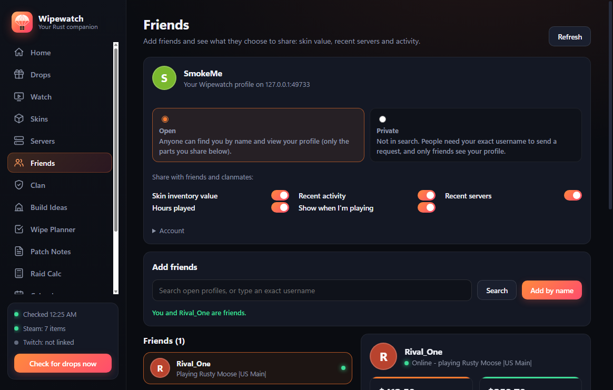
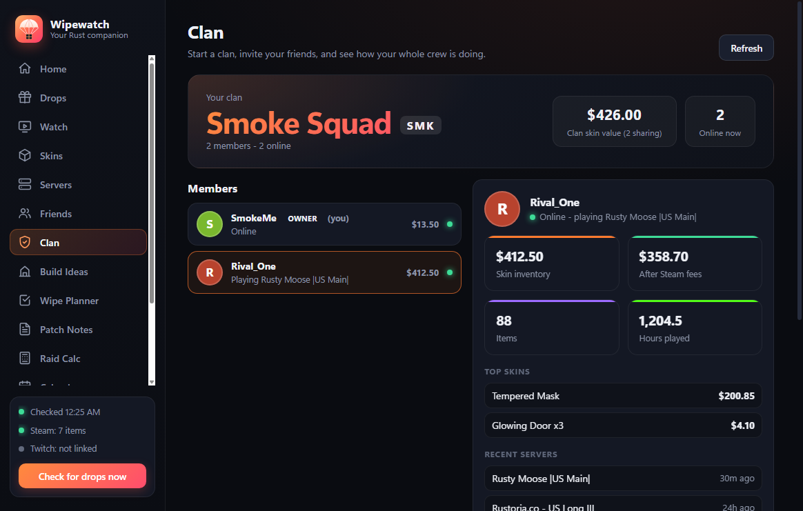
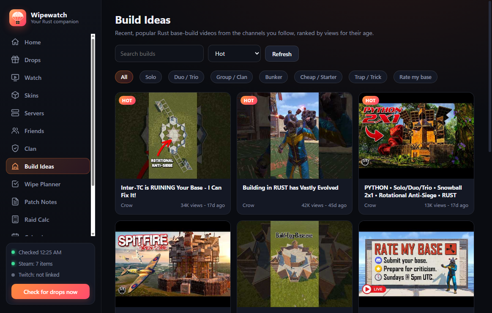
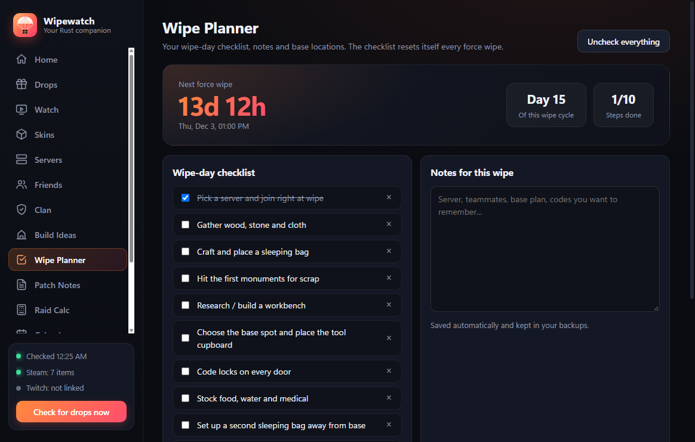
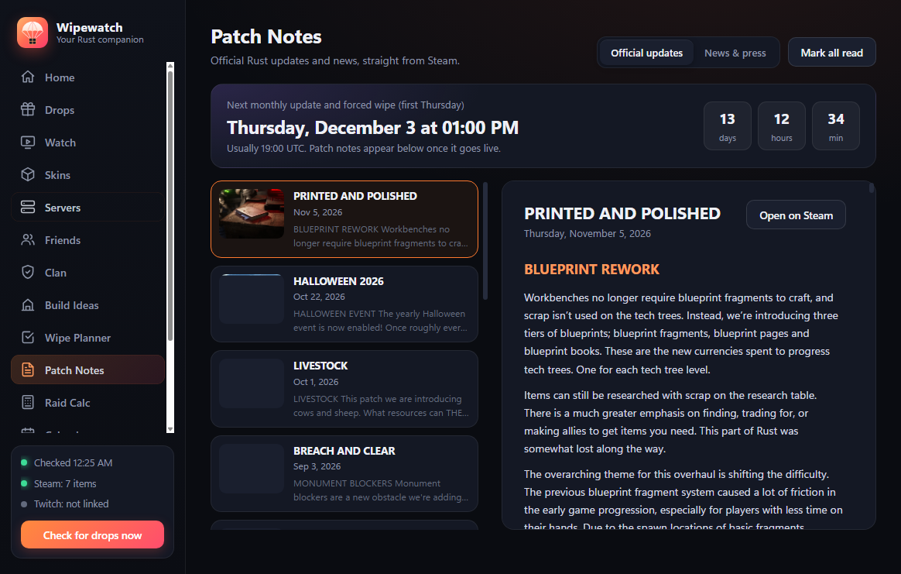
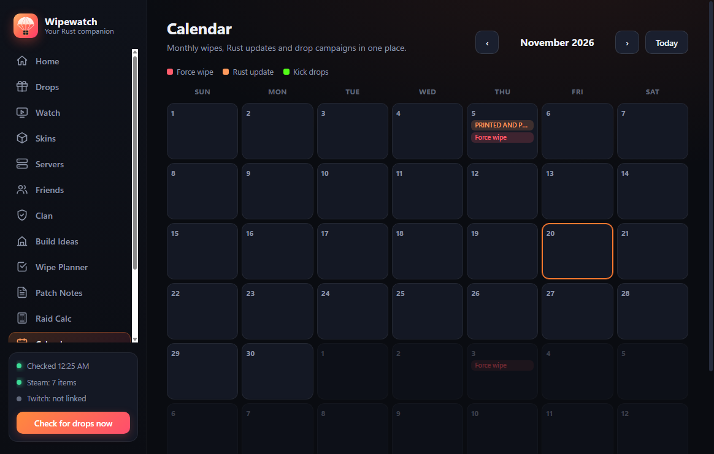

<p align="center">
  
</p>

<p align="center">
  
  
  
  
  
</p>

<h3 align="center">Drops, skins, servers, patch notes, wipe planning and your crew, in one desktop app.</h3>

<p align="center">
  Wipewatch lives in your tray, tells you the moment something happens in Rust, and keeps everything you check between sessions in one place.<br>
  <sub>Not affiliated with Facepunch Studios, Valve, Twitch or Kick. Uses only official or public data sources.</sub>
</p>

---

## What it does

| | |
|---|---|
| **Drops** | Shows whether any Rust drop campaign is live on Kick and Twitch right now, what the rewards are, and your watch progress. "Ending soon" alerts, plus Windows and Discord notifications the moment one starts. |
| **Skins** | Reads your public Steam inventory and prices it from the Steam Market: total value, value after fees, 24h change, price history, price alerts, a watchlist for skins you do not own, cost tracking with profit and loss, CSV export. |
| **Servers** | Searchable server list with live players and queue, the map for the current wipe, favourites, queue / population / wipe alerts and one-click join. See which Steam friends are playing. |
| **Friends and Clans** | Add friends, choose exactly what you share (skin value, activity, recent servers, hours, playing now), keep your profile open or private, and form a clan with a combined skin value. |
| **Build Ideas** | Recent, popular base-build videos from the creators you follow, ranked by views for their age, with filters for solo, duo, bunker, cheap and more. |
| **Wipe Planner** | A wipe-day checklist that resets itself every force wipe, notes, and base pins you drop on a server's map. |
| **Patch Notes** | Official update posts with images and a countdown to the next monthly update and wipe. |
| **Raid Calc** | Explosives and sulfur for a raid. The cost table is editable (the defaults are community figures and not verified). |
| **Extras** | Command palette (`Ctrl+K`), light and dark themes, mini always-on-top overlay, alert sounds, quiet hours, backups, tray menu with live stats, launch animation. |

## A look inside

<table>
  <tr>
    <td width="50%"><br><sub><b>Friends</b> - open or private profile, a switch for everything you share, and each friend's skin value, servers and activity.</sub></td>
    <td width="50%"><br><sub><b>Clans</b> - invite friends, see members and the combined skin value of the crew.</sub></td>
  </tr>
  <tr>
    <td><br><sub><b>Build Ideas</b> - fresh base designs ranked by how fast they are catching on.</sub></td>
    <td><br><sub><b>Wipe Planner</b> - checklist, notes and base pins for the current wipe.</sub></td>
  </tr>
  <tr>
    <td><br><sub><b>Patch Notes</b> - official posts with a live countdown to the next wipe.</sub></td>
    <td><br><sub><b>Calendar</b> - force wipes, updates and drop campaigns by month.</sub></td>
  </tr>
</table>

<sub>Screenshots use demo data.</sub>

## Get it

<p align="center">
  <a href="https://github.com/crayosog-star/wipewatch/releases/latest/download/Wipewatch-Solo-Setup-1.4.0.exe"></a>
</p>

**Wipewatch Solo** is available as a ready-made installer on the [Releases page](https://github.com/crayosog-star/wipewatch/releases/latest): Windows 10/11, per-user install, no admin rights. It is not code-signed, so SmartScreen may ask you to confirm ("More info" then "Run anyway"); the release notes list the SHA-256 checksum to verify your download.

You can also build the installers yourself (nothing is downloaded, it uses the tools already on Windows):

```powershell
git clone https://github.com/crayosog-star/wipewatch.git
cd wipewatch
npm install
npm run installer          # full edition      -> dist\Wipewatch-Setup-<version>.exe
npm run installer:solo     # Solo edition      -> dist\Wipewatch-Solo-Setup-<version>.exe
```

The installer is per-user (no admin rights), adds Start Menu and Desktop shortcuts, and registers an uninstaller. It is not code-signed, so Windows SmartScreen may ask you to confirm.
Run it straight from source with `npm start`.

**Solo edition** is the same app without the Friends and Clan pages and without any of the social code, for people who only want the tools.

## First run

Open **Settings**. Everything is optional, each key or login unlocks one area:

* **Steam account** is found automatically from the Steam client on the PC. Your Steam inventory, friends list and game details need to be **Public** for those pages.
* **Steam Web API key** ([free](https://steamcommunity.com/dev/apikey)) unlocks Servers, Steam friends and My Stats.
* **Twitch Client ID** ([free](https://dev.twitch.tv/console), client type *Public*) unlocks live Twitch drops.
* **Discord webhook** sends alerts to a channel of yours.

Your keys, webhook and Twitch login stay on your PC and are never written into backups.

## Friends and clans

Friends and clans need one shared server that your group points their apps at. It is a single file with no dependencies:

```powershell
node server/server.js          # or: npm run server
```

* **Open** profiles are searchable and viewable by anyone. **Private** profiles are hidden from search, need the exact username to send a request, and only friends and clanmates can view them.
* Every shared field has its own switch and is enforced on the server: a field you turn off is never sent to anyone.
* No emails or passwords. Your PC holds a private account key; the server only keeps a hash of it. You can delete your account from the app.

See [`server/README.md`](server/README.md) for hosting (https is required for anything other than localhost). `npm run test:social` runs about 70 checks against a throwaway server.

## Privacy and data sources

Wipewatch only uses official or public sources: the Steam Web API, Steam Market and Steam News, Kick's public drops feed, the Facepunch drops page, Twitch Helix, Valve's server query protocol, RustMaps public map pages and YouTube's public channel feeds.
It does not use private Twitch or Kick endpoints, so drop progress is the app's own estimate from the time you watch.
Prices come from public Steam Market listings and are only as fresh as Steam's rate limits allow.

## Develop

```powershell
npm install
npm start                    # run from source
npm run smoke                # headless self-test of the whole UI
npm run test:social          # friends / clans server tests
node tools/package.js        # portable build  -> dist\Wipewatch-win32-x64\Wipewatch.exe
```

Smoke test switches: `RDT_REAL=1` uses real Steam data, `RDT_SHOTS=<dir>` renders every page to PNG off-screen, `RDT_DATA=<file>` runs on a copy of a data file.
Your data lives in `%APPDATA%\Rust Drops Tracker` (the folder name predates the project's rename and is kept so nothing is lost).

## Project layout

```
src/            Electron app (main process, preload, renderer pages)
server/         friends and clans server (zero dependencies)
tools/          packaging and installer builders
tests/          server tests
docs/           project site, banner and screenshots
```

---

<p align="center"><sub>Wipewatch is an independent fan tool. Rust is a trademark of Facepunch Studios; Steam is a trademark of Valve; Twitch and Kick belong to their owners.</sub></p>
